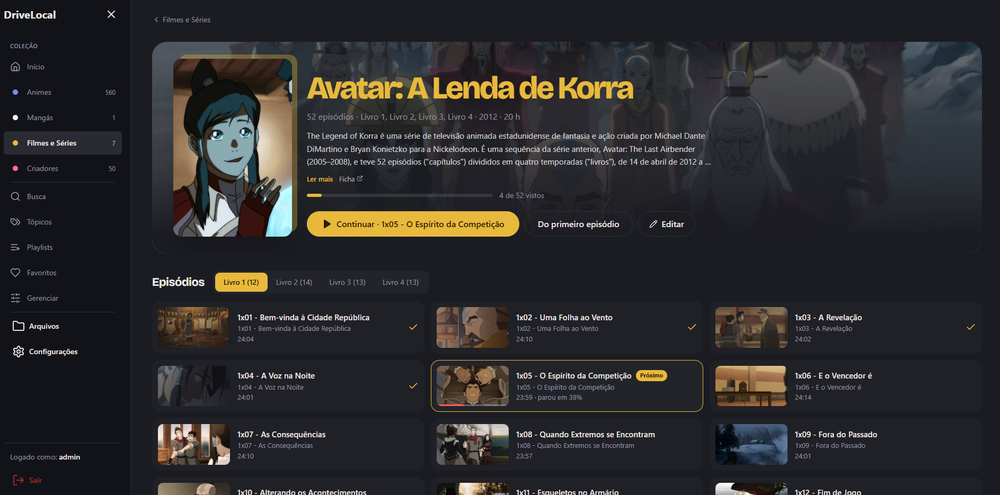
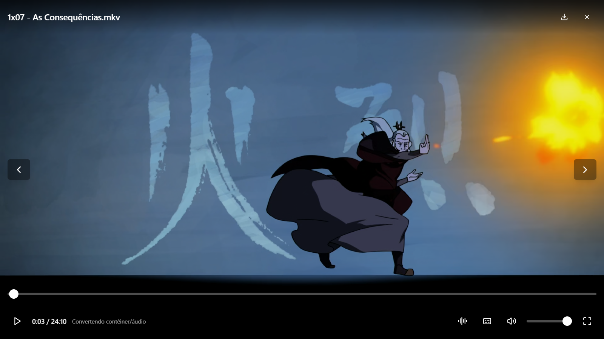

<div align="center">

# DriveLocal

**Your own streaming service, running on your own network.**
A self-hosted media server for anime, series, movies and manga, with a catalog that a local AI helps keep tidy.

[Português](./README.pt-BR.md) · English




</div>

## Why

Folders full of `.mkv` files are not a library. DriveLocal scans them and turns them into one: series grouped by season, synopses, covers and banners, what you have watched and where you stopped. It plays any file in the browser, on any device on your LAN, and nothing leaves your house.

## Highlights

### A catalog that feels like a streaming app

- **Shelves** for anime, series and movies, manga and creators, with a home feed, "continue watching", favorites, playlists and topics
- **Series pages** with seasons, per-episode progress, "next up" and autoplay
- **Metadata from many sources**: AniList, MyAnimeList, Kitsu, TMDB, TVmaze and Wikipedia (synopsis, year, covers, banners), plus an art picker with cropping
- **Manga reader** with reading progress

### A player that plays everything



- **Direct play** when the browser can, and **on-the-fly remux or transcode with FFmpeg** when it can't (MKV, AC3/DTS audio, HEVC…), picked automatically
- Real HTTP Range responses on processed streams, so seeking, reconnecting and long pauses resume at the right frame
- **Audio and subtitle tracks** switchable mid-episode, including styled ASS subtitles with their embedded fonts
- **Remembers your dub and subtitle choice per series**
- Keyboard first: <kbd>Space</kbd> play/pause, <kbd>F</kbd> fullscreen, <kbd>C</kbd> subtitles, <kbd>M</kbd> mute, arrows to seek and change volume

### Curation with AI, under your control

- **Local AI classification**: a model you run yourself (any OpenAI-compatible endpoint, such as llama.cpp or llama-swap) reads file names and, when needed, a frame of the video, then proposes title, series, season, episode and tags
- Answers are **constrained to a JSON schema**, the job runs **only inside a time window** (overnight, for example), and **every result is a suggestion**: nothing touches the catalog until you accept it in the review queue
- Quality is measured against a **golden set** (`eval`), so prompt or model changes can be compared
- **Duplicate detection** for series and creators with different spellings (token set ratio, Jaro-Winkler and containment), with merges that keep aliases and can be undone
- **Rules, batch operations with dry-run, change history and undo** for everything that edits the catalog

### Built for agents

DriveLocal has **API tokens** and a CLI, `drivelocal-cli`. An AI agent (Claude Code, or any assistant with shell or MCP tools) can search the catalog, look up metadata, prepare a batch, run it as a dry-run, then apply or undo it. Bulk curation becomes a conversation instead of an afternoon of clicking.

```bash
export DRIVELOCAL_URL=http://localhost
export DRIVELOCAL_TOKEN=dlt_...        # created by an admin: POST /api/admin/library/tokens

drivelocal-cli search "korra"
drivelocal-cli review --kind topic     # pending AI suggestions
drivelocal-cli accept 812 813
drivelocal-cli batch fixes.json --dry  # preview first
drivelocal-cli undo 42                 # every batch can be undone
```

### Self-hosted, multi-user

- Login with httpOnly cookies, short-lived access tokens with silent refresh, and "remember me"
- Roles and permissions (read, write, delete, admin); progress, favorites and track choices per user
- One `docker compose up`; libraries can be added from the UI through a small host helper

## Quick start (Docker)

```bash
git clone https://github.com/patitow/drivelocal.git
cd drivelocal
cp .env.example .env
cp server-go/server/data/users.example.json server-go/server/data/users.json
cp docker-compose.override.example.yml docker-compose.override.yml
```

Point the override at your media folders:

```yaml
services:
  drivelocal:
    volumes:
      - "D:/Anime:/data/Anime:ro"
      - "D:/Movies:/data/Movies:ro"
```

```bash
docker compose up -d --build
```

Open http://localhost (or http://127.0.0.1:8080 if port 80 is taken). The example login is `admin` / `admin`, so change it before exposing the server to your LAN.

> Don't also mount `./media:/data:ro` next to nested binds like `/data/Anime`: a read-only `/data` stops Docker from creating the mount points.

## Configuration

| Variable | What it does | Default |
| --- | --- | --- |
| `HOST_LAN_IP` | LAN IPv4 of the host, so the app shows the right address | empty |
| `AUTH_ENABLED` | Turns login on or off | `true` |
| `TZ` | Timezone | `UTC` |
| `TMDB_API_KEY` | Movie and series metadata from TMDB | empty |
| `MAL_CLIENT_ID` | MyAnimeList API (falls back to Jikan) | empty |
| `AI_BASE_URL` | OpenAI-compatible endpoint for the local AI | empty (AI off) |
| `AI_API_KEY` | Key for that endpoint | empty |
| `AI_TEXT_MODEL` / `AI_VISION_MODEL` | Models for text and vision | see `.env.example` |
| `AI_WINDOW` / `AI_TZ` | When the AI is allowed to run | `01:00-08:00` |

Keys live only in `.env`, which is git-ignored.

## Development

Requirements: [Go 1.24+](https://go.dev/dl/), [Node.js 18+](https://nodejs.org/) and FFmpeg.

```bash
cd client && npm install && cd ..
npm run dev                 # Vite on :3000, API on :5000
```

```bash
cd server-go && go test ./...
cd client && npx vitest run
npm run test:playwright     # end-to-end
```

## Stack

| Layer | Tech |
| --- | --- |
| Server | Go, SQLite, FFmpeg / ffprobe |
| Client | React, TypeScript, Vite, TanStack Router and Query, Tailwind |
| AI | Any OpenAI-compatible local model (text and vision) |
| Packaging | Docker Compose, plus an optional host helper for mounting folders |

```
drivelocal/
├── client/          # React app
├── server-go/       # API, scanner, streaming, AI curation, CLI (cmd/drivelocal-cli)
├── host-helper/     # optional helper to mount host folders from the UI
├── docker-compose.yml
└── tests/           # Playwright
```

## License

MIT, see [LICENSE](./LICENSE).
